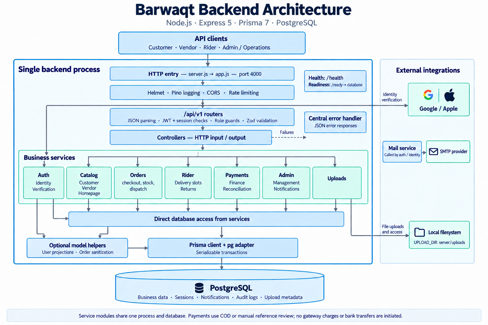
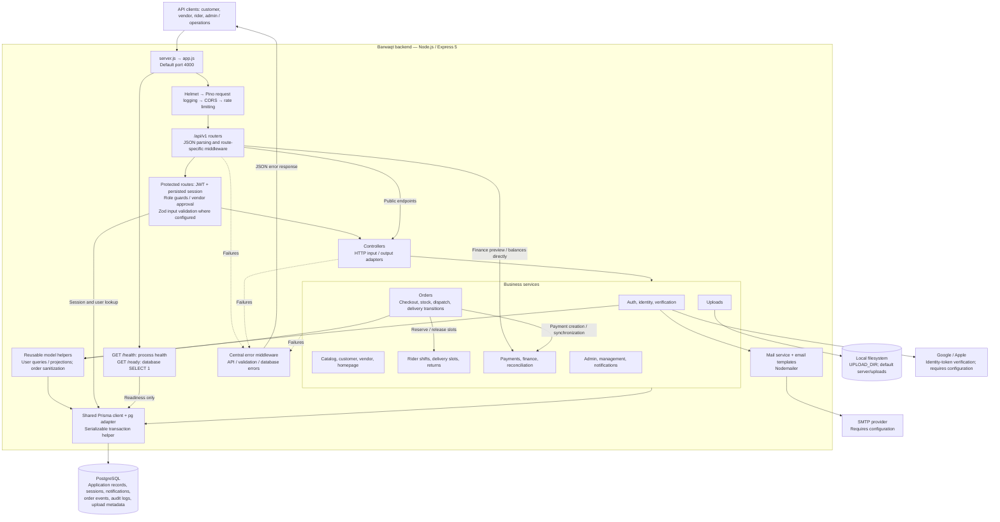
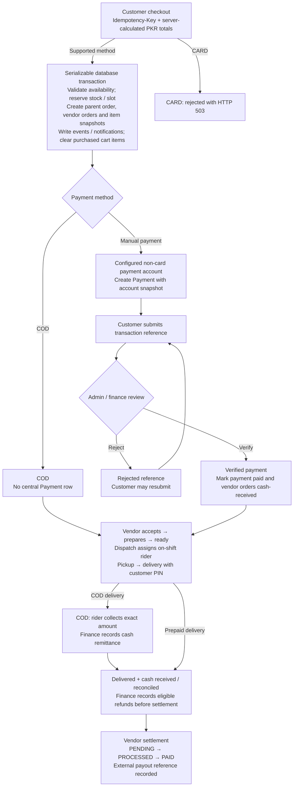

# Backend architecture

This diagram describes the implementation in `server/src`: one Node.js / Express 5 application with domain services, Prisma 7, and PostgreSQL. Service boxes are modules in the same process, not separately deployed services.

## Architecture image

The image summarizes the system; the Mermaid diagram below provides the detailed connections.

## System and application layers

Most handlers follow **router → middleware → controller → service → Prisma**. Services also use Prisma directly; `src/models` is a small set of reusable helpers, not a mandatory repository layer. Finance preview and rider balance routes call reconciliation services directly.

The upload router is mounted before the global 256 KB JSON parser and uses its own 7 MB parser for base64 uploads, with a 5 MB decoded-file limit. File bytes live on disk; metadata lives in PostgreSQL. Image content is public, while document content requires its owner or an administrator.

## Route-to-domain map

All prefixes below are relative to `/api/v1`.

| Route prefix | Main responsibilities |
| --- | --- |
| `/auth` | Registration, login, sessions, password recovery, verification, social identity |
| `/catalog` | Public categories, products, vendors, homepage content |
| `/customer` | Addresses, cart, wishlist, reviews |
| `/orders` | Quotes, checkout, order access and workflow actions |
| `/vendor` | Vendor products, orders, settings and financial summaries |
| `/rider` | Shifts, assignments and rider actions |
| `/delivery` | Delivery-slot management and availability |
| `/returns` | Return requests and operational actions |
| `/payments` | Platform payment accounts, customer references and staff review |
| `/finance` | Cash remittances, refunds, reconciliation and settlements |
| `/admin` | Vendor / staff administration, catalog management, coupons, homepage publishing and reports |
| `/notifications` | Persisted in-app notifications and read status |
| `/uploads` | File creation, listing, content retrieval and deletion |

## Order and payment flow

This is the successful fulfillment path plus payment-review rejection. Cancellation, vendor rejection, failed delivery, retry and return handling are implemented in the order / return services. Payment verification after cancellation can create a refund obligation instead of enabling fulfillment.

Non-COD payments record customer references for manual review; the backend does not initiate gateway charges or bank transfers. Settlements and refunds record externally completed financial actions. Amounts are integer PKR minor units (paisa).

## Persistence and runtime boundaries

- **Identity:** `User`, `Session`, `PasswordReset`, `EmailVerification`, `AuthChallenge`.
- **Commerce:** `Vendor`, `Category`, `Product`, `Address`, `CartItem`, `WishlistItem`, `Coupon`, `Review`, `StorefrontPage`.
- **Fulfillment:** `Order`, `VendorOrder`, `OrderItem`, `OrderEvent`, `Shift`, `DeliverySlot`, `ReturnRequest`.
- **Finance:** `PaymentAccount`, `Payment`, `PaymentSubmission`, `Remittance`, `Settlement`, `Refund`, `VendorAdjustment`.
- **Supporting records:** `Notification`, `AuditLog`, `Upload`.

The shared connection pool allows up to 10 connections. The transaction helper uses serializable isolation and retries PostgreSQL transaction conflicts reported as Prisma `P2034`, for up to four attempts. Database migrations also enforce relational and business constraints.

The server connects to PostgreSQL before accepting requests and closes the HTTP server and database connection on shutdown. Local Docker Compose provisions PostgreSQL 16. Rate limits are held per process. Email is sent through SMTP in the request/service flow; there is no separate queue, worker, Redis cache, WebSocket server, or push-notification provider in this implementation. In-app notifications are stored in PostgreSQL and read through the API.

## Source references

- [Application composition and middleware](../src/app.js)
- [Startup and shutdown](../src/server.js)
- [Database client and transaction helper](../src/config/database.js)
- [Authentication and role guards](../src/middlewares/auth.middleware.js)
- [Order workflow](../src/services/order.service.js)
- [Payment review](../src/services/payment.service.js) and [finance](../src/services/finance.service.js)
- [Upload storage](../src/services/upload.service.js)
- [Relational schema](../prisma/schema.prisma)

Open this document in a Mermaid-capable Markdown preview to view the diagrams.
